

---

# Detection of unusual astronomical events in supernova catalogues

**Csongor Szász**

Advisor: Zalán Bodó, PhD., Associate Professor

Babeș-Bolyai University of Cluj-Napoca, Faculty of Mathematics and Computer Science

Bachelor's Thesis · 2025

---

**Abstract**

The number of [supernova](https://en.wikipedia.org/wiki/Supernova) discoveries per year has been rapidly growing, with only [538 events in the year 2010](https://doi.org/10.1086/671483), while [in 2024 alone it reached 23887 (>4300% increase)](https://www.rochesterastronomy.org/sn2024/snstats.html). With the launch of new, more advanced sky surveys like the [Legacy Survey of Space and Time (LSST)](https://rubinobservatory.org/),
supernova candidates will grow to the hundreds of thousands or even millions per year. Misclassifications are inevitable and verifying so many events manually quickly becomes unmanageable. This poses the need to automate flagging potentially anomalous candidates in order to
clean the dataset. To date, there are only a handful of publicly known projects trying to solve this exact problem of anomaly detection across supernova candidates. This thesis is an attempt at improving the accuracy of the anomaly detection pipeline presented in the paper: [Anomaly Detection in the Open Supernova Catalog (Pruzhinskaya M. et al. 2019)](https://academic.oup.com/mnras/article/489/3/3591/5554761?login=false). My approach consists of modifying or replacing the regression, the dimensionality reduction, and the outlier detection algorithms with other methods.

---

# Main contributions
1. **Dimensionality reduction.** Addition of Uniform Manifold Approximation and Projection (UMAP), known to preserve both local and global topological structures, in contrast to the used t-distributed Stochastic Neighbor Embedding (t-SNE) which does not preserve global distances or densities.
2. **Anomaly detection.** Ensembling the Isolation Forest with another anomaly detection algorithm, namely, the One-class Support Vector Machine (SVM), thereby increasing the credibility of the final outlier set.
3. **Dataset.** Using the 2022 version of the Open Supernova Catalog (~100000 observations) instead of the 2018 one (~50000 observations, half of version 2022).

# About supernovae
A _supernova_ is the grandiose explosion of certain types of stars at the end of their stellar evolution. The observation of supernovae enables us to improve our model of the universe. Among other things, it has led to the discovery of the _accelerating expansion of the universe_ (not decelerating, not constant), rewarded with the [Nobel Prize in Physics in 2011](https://www.nobelprize.org/prizes/physics/2011/press-release/).

# Problem statement
With the progression of telescope technology, there are now orders of magnitude more deep space observation data produced daily than there are human experts to analyse them. Consequently, that data is now automatically preprocessed and analysed before it gets to a human. Misclassifications happen inevitably, and an object that is some type of never-before-seen black hole is mistakenly classified as a supernova, and placed into a catalogue of other supernovae. By failing to notice misclassified cases we lose out on interesting new insights.

# Representation of a supernova-like object
Supernovae are mainly identified by the shape of their _light curve_. Here we focus only on visible light (red, green, blue) and infrared, as the available data is most abundant there. 

_Anomalies_ are light curves that exhibit supernova-like properties but do not exactly fit the supernova-distribution present in the dataset. Anomalies can be caused by data bugs or, more excitingly, yet undiscovered astrophysical phenomena. It is up to domain experts (astronomers) to confirm an anomaly.

# Methods

### Light curve approximation (building a continuous light curve from observations)
> Error bars show the uncertainty of an observation data point; shaded areas show the uncertainty of a light curve approximation.

### Dimensionality reduction (2D projection of light curves, clustered by similarity)

> Top row: t-SNE; bottom row: UMAP.
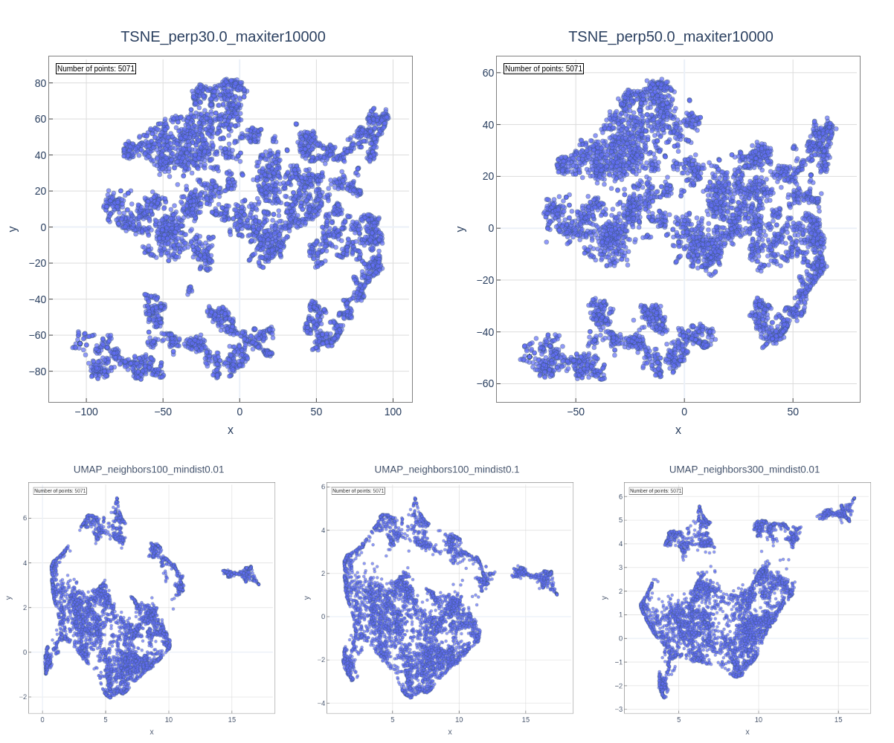

### Anomaly detection (identifying outlier light curves)
> Lower _decision score_ and _anomaly score_ mean less normal behaviour. The circled points are only _candidate_ outliers.
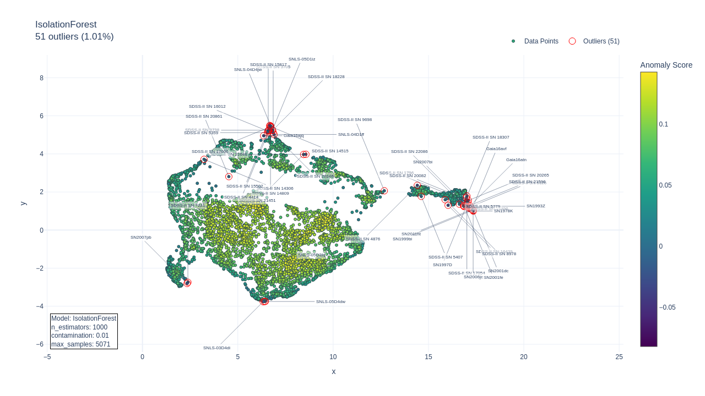
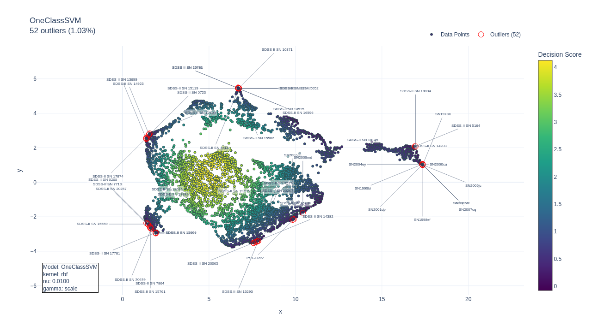
Notice how the above two methods (1. Isolation Forest, 2. One-class SVM) flag a different subset of outliers. The intersection of the subsets gives a more confident result than relying on the output of a single model family. Pruzhinskaya et al. use the output of only the Isolation Forest.

# Results

List of **potential outliers** identified by me: [results/identified_outliers/possible_outliers.csv](results/identified_outliers/possible_outliers.csv).

List of **officially confirmed outliers** (Pruzhinskaya M. et al., 2019): [officially_confirmed_outliers.csv](officially_confirmed_outliers.csv).

The following are a few representative instances of what _is_ and what _is not_ an anomaly:

### False positive anomalies caused by wrong or incomplete data (data anomalies)

> [SN2005ho](https://www.wikidata.org/wiki/Q11835574) (officially confirmed standard Type Ia supernova, included in the Joint Light-Curve Analysis (JLA) (Pruzhinskaya M. et al., 2019))
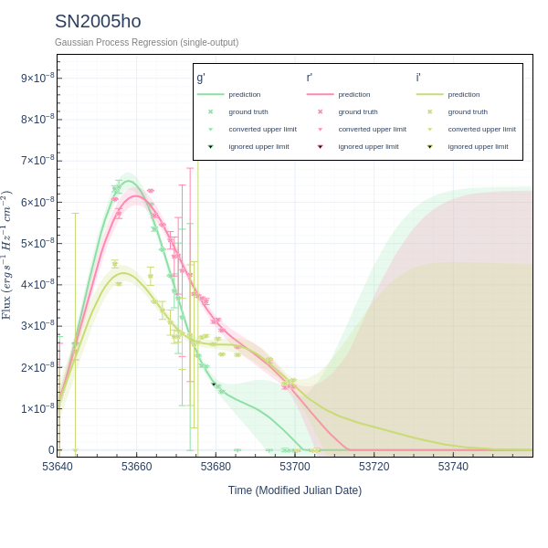

> [SN2007jm](https://www.wikidata.org/wiki/Q9330551) (Type IIn supernova)
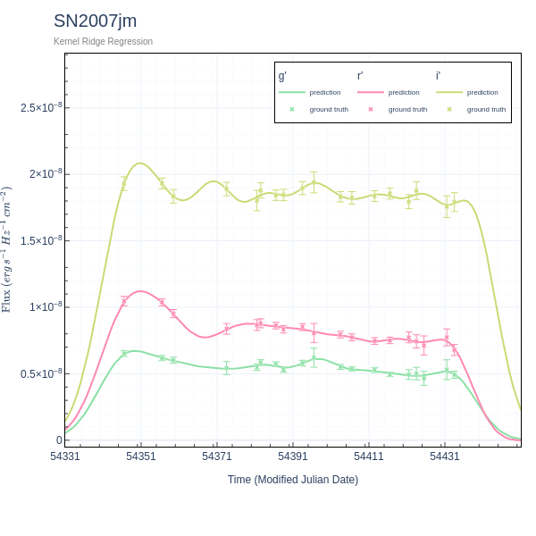

> [SN2016ixf](<https://rochesterastronomy.org/sn2016/index.html#:~:text=Gaia%20observations)-,2016ixf,-(%3D%20Gaia16cdf)%20(%3D%20PS17bll)%20discovered>) (standard Type Ia supernova)
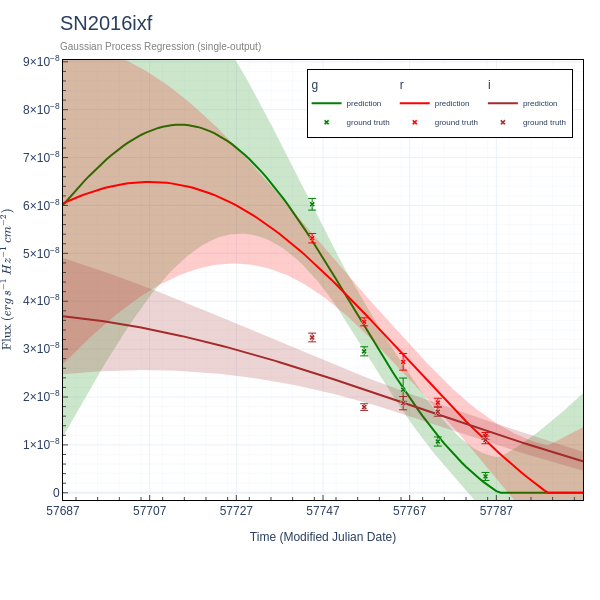

> [SN2017ckx](https://www.wis-tns.org/object/2017ckx) (Type Ia supernova)
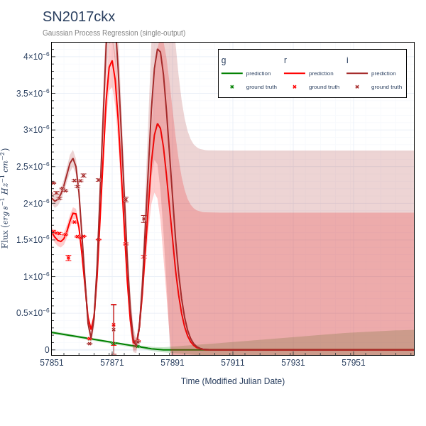

### True (astrophysical) anomalies

> SN2006kg (active galactic nucleus (AGN) (Pruzhinskaya M. et al., 2019))
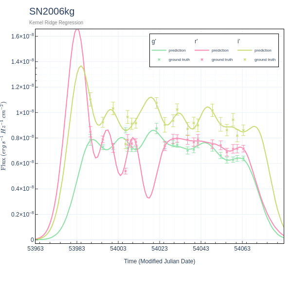

> [Gaia16aye](https://en.wikipedia.org/wiki/Gaia16aye) (binary gravitational microlensing event)
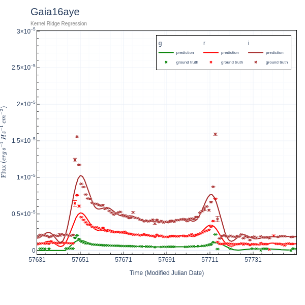

> [PTF10aagc](<https://rochesterastronomy.org/sn2010/index.html#:~:text=LEDA%201503420)-,PTF10aagc,-discovered%202010/01>) (Type I Superluminous Supernova (SLSN-I))
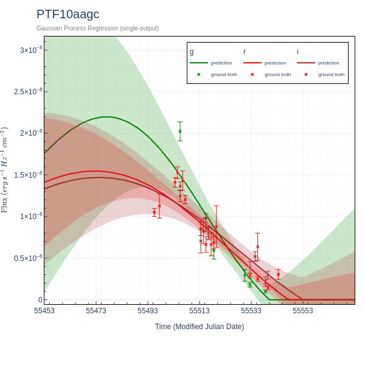

> [Gaia16azl](https://gsaweb.ast.cam.ac.uk/alerts/alert/Gaia16azl/) (candidate classical nova, uniquely identified in this work and not in Pruzhinskaya M. et al., 2019)
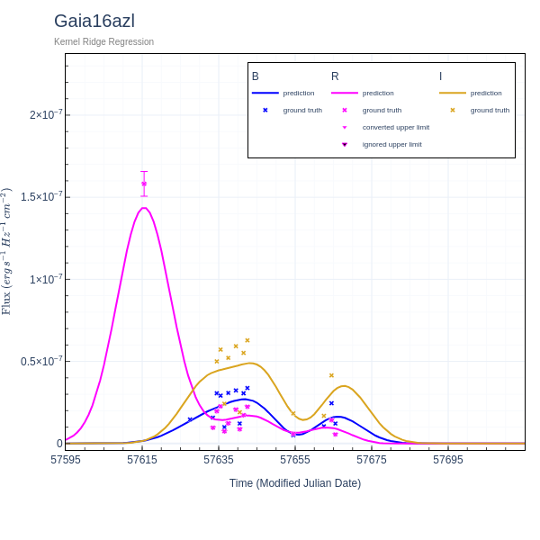

# End note
Some promising potential anomalies (such as Gaia16azl above) have been identified here that Pruzhinskaya et al., 2019 have not identified; however, these candidates were not officially confirmed with astronomers.

Only 4 of ~25 confirmed anomalies from Pruzhinskaya et al., 2019 have been identified in this work. One possible reason is the stricter anomaly detection phase employed here which requires two distinct outlier detection models to agree.

# References
M V Pruzhinskaya, K L Malanchev, M V Kornilov, E E O Ishida, F Mondon, A A Volnova, V S Korolev, Anomaly detection in the Open Supernova Catalog, Monthly Notices of the Royal Astronomical Society, Volume 489, Issue 3, November 2019, Pages 3591–3608, [https://doi.org/10.1093/mnras/stz2362](https://doi.org/10.1093/mnras/stz2362)